<div align="center">

# AdventureWorks · Data Pipeline

### Do banco transacional à análise de vendas

Pipeline ETL com extração incremental, Data Warehouse dimensional e orquestração com Apache Airflow.


[Visão geral](#visão-geral) · [Arquitetura](#arquitetura) · [Como executar](#como-executar) · [Indicadores](#indicadores-de-negócio) · [Galeria](#galeria)

</div>

---

## Visão geral

Este projeto transforma dados de vendas do **AdventureWorks2019**, no SQL Server, em um **Data Warehouse no PostgreSQL**. O Apache Airflow coordena a criação das estruturas, a extração incremental, as cargas dimensionais e o cálculo de dez indicadores de negócio.

A proposta reúne, em um ambiente Docker Compose, as principais etapas de um fluxo de engenharia de dados: integração entre bancos, staging, modelagem estrela, controle de processamento e consultas analíticas.

- **Carga incremental:** seleção por `ModifiedDate`, com watermark independente para cada tabela.
- **Reprocessamento idempotente:** upserts e comparação de conteúdo evitam duplicação e atualizações desnecessárias.
- **Modelo dimensional:** uma fato de vendas conectada às dimensões produto, cliente, território e calendário.
- **Rastreabilidade:** registro da janela de extração e das quantidades de registros lidos e alterados.
- **Ambiente automatizado:** download e restauração do AdventureWorks e inicialização do Airflow pelo Compose.

## Arquitetura

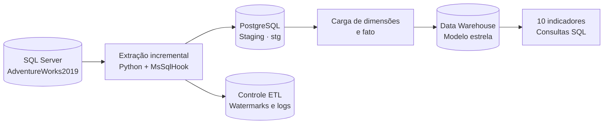

O **Apache Airflow** orquestra todo o fluxo com `LocalExecutor`. O PostgreSQL armazena tanto os metadados do Airflow quanto os dados do projeto: as tabelas de staging ficam no schema `stg`, os controles no schema `etl` e as tabelas dimensionais usam o prefixo `dw_` no schema padrão.

### Fluxo do DAG principal

O DAG **`etl_incremental_adventureworks`** possui 12 tarefas e agendamento diário (`@daily`), sem recuperação automática de períodos passados (`catchup=False`) e com uma execução ativa por vez.

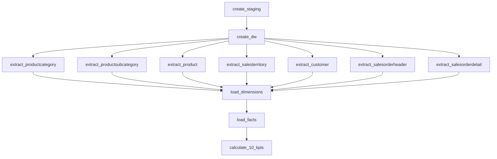

As sete extrações podem executar em paralelo, respeitando os limites configurados no Airflow. Cada tarefa tem uma tentativa adicional em caso de falha, com intervalo de um minuto.

### Estratégia incremental

1. Na primeira execução, são extraídos os registros com `ModifiedDate` até o horário consultado na origem.
2. Nas próximas execuções, a seleção começa **um dia antes do último watermark**, permitindo reler registros próximos ao limite da carga anterior.
3. Os dados são lidos em lotes de até **5.000 registros** e gravados na staging com `INSERT ... ON CONFLICT`.
4. Staging, watermark e log de extração são confirmados na mesma transação PostgreSQL, por tabela. Um lock transacional evita extrações simultâneas da mesma tabela por esse código.
5. As cargas do DW reavaliam a staging e atualizam apenas registros com conteúdo diferente. As dimensões seguem **SCD tipo 1**, substituindo os atributos anteriores.

> A estratégia depende da atualização de `ModifiedDate` na origem. Exclusões físicas e alterações retroativas fora da janela de sobreposição não são detectadas automaticamente. As cargas dimensionais e da fato consultam toda a staging; o filtro incremental é aplicado na extração do SQL Server.

## Modelo dimensional

O grão de **`dw_f_vendas`** é **um item de pedido**, identificado de forma única por `sales_order_detail_id`. A fato armazena quantidade, preço unitário, desconto, custo padrão e valor total, além das chaves para as quatro dimensões:

- **`dw_d_produto`** — produto, número, categoria e subcategoria.
- **`dw_d_cliente`** — identificação, nome e tipo de cliente: loja ou pessoa física.
- **`dw_d_territorio`** — território, país e região; inclui um membro para território não informado.
- **`dw_d_calendario`** — datas entre o menor e o maior pedido disponível na staging, com atributos de ano, mês, trimestre e dia.


Os campos monetários usam `NUMERIC(19,4)`, e os totais de linha usam `NUMERIC(38,6)`. O arquivo [`migrate_precision.sql`](dags/sql/migrate_precision.sql) ajusta essas precisões em estruturas existentes e cria índices nas chaves dimensionais da fato.

## Como executar

### Pré-requisitos

- Docker com suporte a containers Linux e Docker Compose v2.
- Git para clonar o repositório.
- Acesso à internet no primeiro início para baixar imagens, dependências Python e o backup do AdventureWorks.
- Memória disponível para os serviços: os limites configurados no Compose somam aproximadamente **7 GB**, além do consumo do Docker e do sistema operacional.
- Portas `8080`, `5433` e `1433` livres na configuração padrão.

Os exemplos abaixo usam **PowerShell**, a partir da raiz do projeto.

### 1. Obtenha o projeto

```powershell
git clone https://github.com/davs22/ApacheAirflow-e-ETL.git
cd ApacheAirflow-e-ETL
```

### 2. Configure o ambiente

Crie o arquivo local de configuração, preservando um `.env` existente:

```powershell
if (!(Test-Path .env)) { Copy-Item .env.example .env }
```

Edite o `.env` e configure:

- `AIRFLOW_FERNET_KEY`: chave Fernet válida para o Airflow.
- `AIRFLOW_API_SECRET_KEY` e `AIRFLOW_JWT_SECRET`: segredos aleatórios distintos.
- `POSTGRES_USER`, `POSTGRES_PASSWORD` e `POSTGRES_DB`: acesso ao PostgreSQL.
- `_AIRFLOW_WWW_USER_USERNAME` e `_AIRFLOW_WWW_USER_PASSWORD`: acesso à interface do Airflow.
- `MSSQL_SA_PASSWORD`: senha do usuário `sa`, atendendo à política de complexidade do SQL Server.

Para gerar as três chaves usando a própria imagem do Airflow:

```powershell
docker run --rm --entrypoint python apache/airflow:3.3.1 -c "from cryptography.fernet import Fernet; import secrets; print('AIRFLOW_FERNET_KEY=' + Fernet.generate_key().decode()); print('AIRFLOW_API_SECRET_KEY=' + secrets.token_hex(32)); print('AIRFLOW_JWT_SECRET=' + secrets.token_hex(32))"
```

Copie cada valor gerado para a variável correspondente no `.env`. Esse arquivo já está no `.gitignore`; mantenha as credenciais fora do controle de versão.

### 3. Inicie os serviços

```powershell
docker compose up -d
docker compose ps --all
```

O Compose baixa o backup `AdventureWorks2019.bak`, restaura o banco caso ainda não exista, migra os metadados do Airflow e cria o usuário da interface. A primeira inicialização pode levar alguns minutos.

Aguarde a conclusão dos serviços `sqlserver-backup`, `sqlserver-init` e `airflow-init` com código de saída **0**, e verifique a saúde dos serviços que possuem healthcheck. Os componentes contínuos são PostgreSQL, SQL Server, API server, scheduler, DAG processor e triggerer.

### 4. Execute o pipeline

Abra **[localhost:8080](http://localhost:8080)** e entre com as credenciais definidas no `.env`.

1. Localize `etl_incremental_adventureworks`.
2. Ative o DAG, criado inicialmente em pausa.
3. Dispare uma execução manual e acompanhe as tarefas e seus logs.
4. Após a carga, consulte as tabelas `dw_` no PostgreSQL e os resultados da tarefa `calculate_10_kpis`.

As conexões **`postgres_default`** e **`mssql_adventureworks`** já são configuradas pelo Compose. O DAG principal cria as próprias estruturas; os DAGs auxiliares são opcionais.

## Indicadores de negócio

O arquivo [`kpis_adventureworks.sql`](dags/sql/kpis_adventureworks.sql) contém dez consultas executadas ao final do pipeline:

1. **Faturamento líquido** — soma dos valores totais dos itens.
2. **Custo total estimado** — quantidade multiplicada pelo custo padrão do produto.
3. **Lucro bruto estimado** — faturamento menos custo estimado.
4. **Margem bruta estimada (%)** — lucro estimado em relação ao faturamento.
5. **Total de pedidos** — contagem distinta dos pedidos de venda.
6. **Ticket médio por pedido** — faturamento dividido pela quantidade de pedidos.
7. **Unidades vendidas** — soma das quantidades dos itens.
8. **Faturamento por categoria** — receita agrupada pela categoria do produto.
9. **Faturamento por região e território** — distribuição geográfica da receita.
10. **Top 10 produtos por lucro bruto estimado** — produtos com maior contribuição estimada.

> A receita considera o total dos itens após descontos, sem frete e impostos. O custo usa o `StandardCost` atual do produto, portanto lucro e margem são estimativas, sem reconstrução do custo histórico contábil. Os resultados são impressos nos logs da tarefa; as consultas não criam tabelas de indicadores.

## Operação e acompanhamento

Para verificar erros de importação e acompanhar os serviços:

```powershell
docker compose exec -T airflow-scheduler airflow dags list-import-errors
docker compose logs -f airflow-scheduler
```

Para executar o DAG completo pelo comando de teste do Airflow:

```powershell
docker compose exec -T airflow-scheduler airflow dags test etl_incremental_adventureworks
```

Esse comando **executa as tarefas e grava nos bancos configurados**. Utilize-o com os serviços prontos e sem uma execução concorrente do pipeline.

### DAGs auxiliares

Os três DAGs abaixo possuem execução manual, sem agendamento:

- **`etl_build_schema_stg_adventureworks`** — cria as estruturas de staging e controle ETL.
- **`etl_build_schema_dw_adventureworks`** — cria as dimensões e a fato do modelo estrela.
- **`etl_extract_mssql_adventureworks`** — prepara a staging e executa as sete extrações.

Evite executá-los em paralelo com o DAG principal durante manutenções.

### Conexão pelo DBeaver ou outro cliente SQL

- **PostgreSQL:** host `localhost`, porta `5433` e banco, usuário e senha definidos no `.env`. A porta pode ser alterada por `POSTGRES_HOST_PORT`.
- **SQL Server:** host `localhost`, porta `1433`, banco `AdventureWorks2019`, usuário `sa` e senha `MSSQL_SA_PASSWORD`.
- **Airflow:** interface na porta `8080`, configurável por `AIRFLOW_PORT`.

Entre containers, o PostgreSQL é acessado por `postgres:5432` e o SQL Server por `sqlserver:1433`.

### Persistência e diagnóstico

Os bancos e o backup utilizam volumes Docker. Para parar o ambiente preservando os dados:

```powershell
docker compose down
```

O parâmetro `-v` remove os volumes e seus dados. As pastas `dags`, `logs`, `plugins`, `config` e `data` são montadas em `/opt/airflow`.

Se houver falha na inicialização, consulte os logs dos serviços de preparação:

```powershell
docker compose logs sqlserver-backup sqlserver-init airflow-init
```

Mantenha os provedores `apache-airflow-providers-postgres`, `apache-airflow-providers-microsoft-mssql` e `apache-airflow-providers-standard` ao personalizar `_PIP_ADDITIONAL_REQUIREMENTS`. O módulo compartilhado também utiliza `sqlparse`, disponível na imagem do Airflow. Em caso de pressão de memória, ajuste `AIRFLOW_PARALLELISM` e `AIRFLOW_MAX_ACTIVE_TASKS_PER_DAG`.

## Estrutura do projeto

```text
ApacheAirflow-e-ETL/
├── dags/
│   ├── aw_pipeline.py
│   ├── etl_incremental_vendas.py
│   ├── etl_extract_mssql_to_stg.py
│   ├── etl_build_schema_stg.py
│   ├── etl_build_schema_dw.py
│   └── sql/
│       ├── stg_adventureworks.sql
│       ├── dw_d_*.sql
│       ├── dw_f_vendas.sql
│       ├── migrate_precision.sql
│       ├── load_dimensions.sql
│       ├── load_facts.sql
│       └── kpis_adventureworks.sql
├── data/
│   ├── diagrama/
│   └── img/
├── .env.example
├── .gitignore
├── docker-compose.yml
└── readme.md
```

[`aw_pipeline.py`](dags/aw_pipeline.py) concentra a extração incremental, a execução dos SQLs e a inicialização do DW. [`etl_incremental_vendas.py`](dags/etl_incremental_vendas.py) define as tarefas e dependências do fluxo principal. O ambiente usa o arquivo `docker-compose.yml`; `docker-compose.yml.bak` é uma cópia de configuração anterior.

## Galeria

Registros visuais disponíveis no repositório.

### DAGs no Airflow

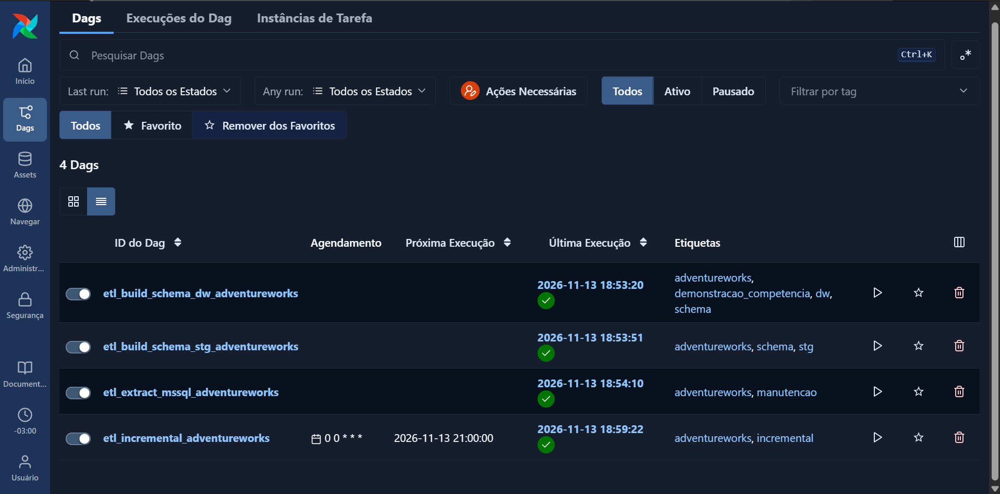

<details>
<summary><strong>Pipeline incremental e logs</strong></summary>

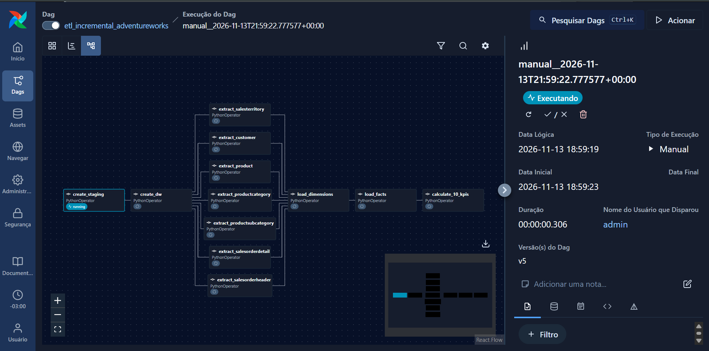

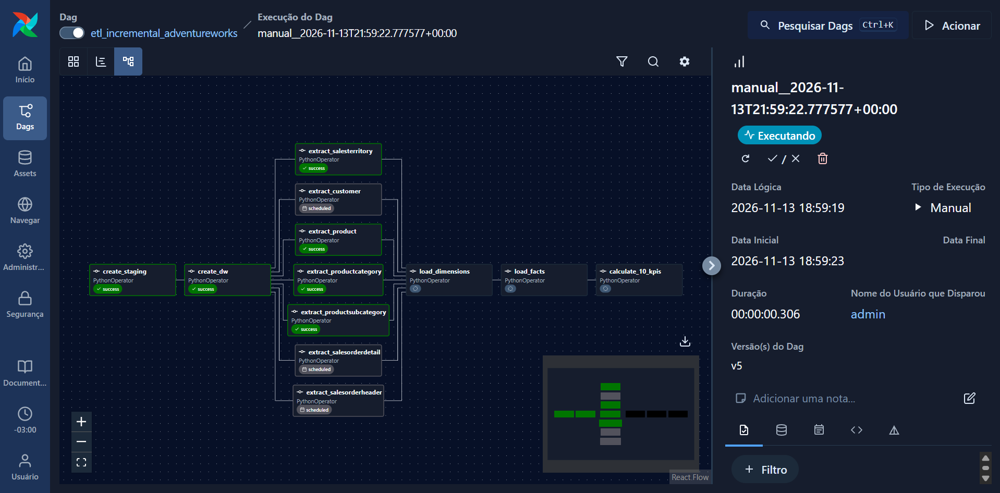

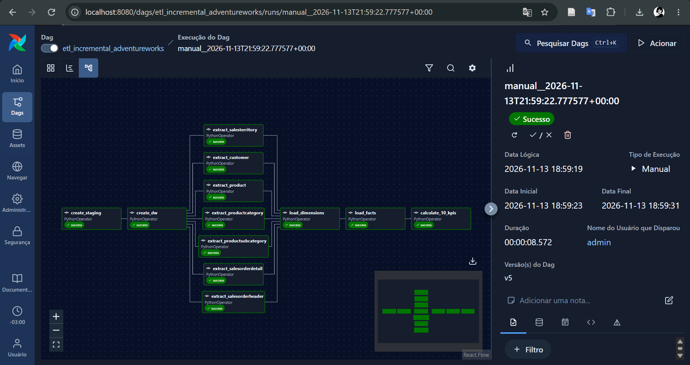

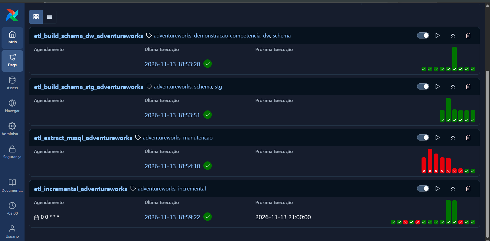

</details>

<details>
<summary><strong>Criação das estruturas e extração</strong></summary>

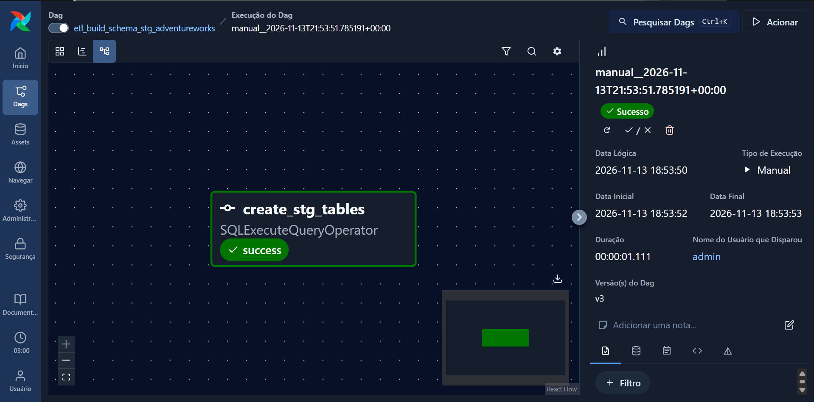

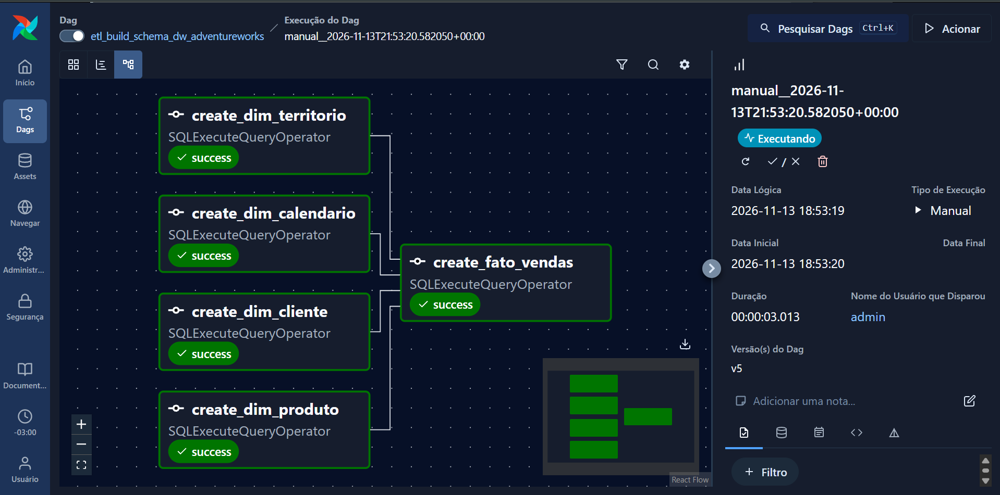

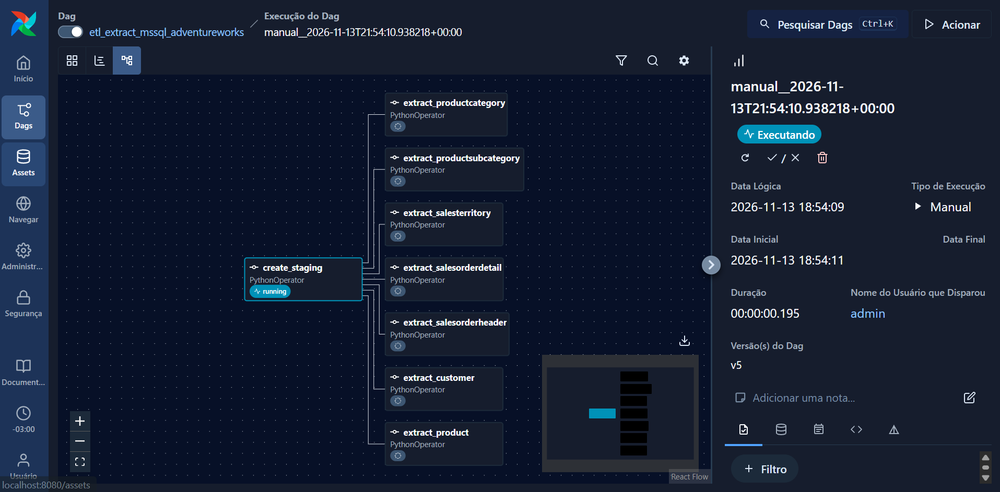

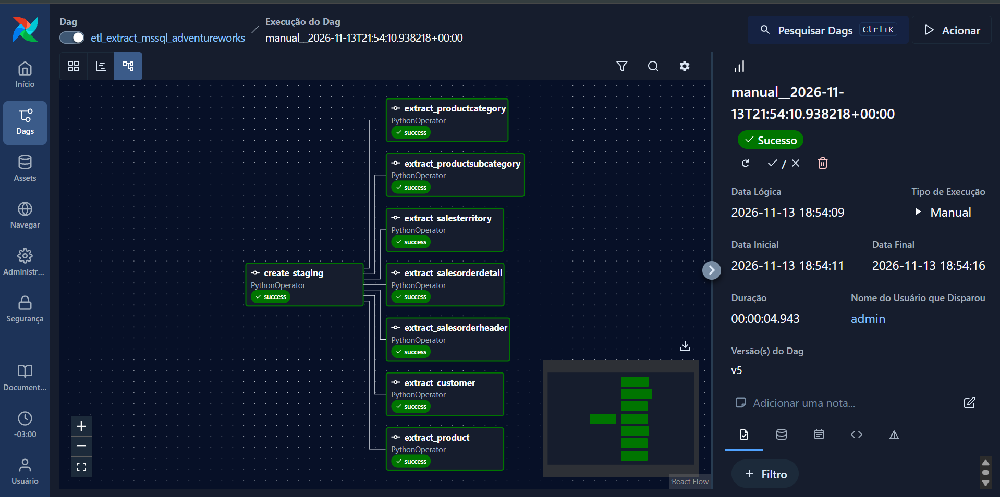

</details>

---

<div align="center">

**AdventureWorks · Apache Airflow · PostgreSQL · Docker**

[Acessar o repositório](https://github.com/davs22/ApacheAirflow-e-ETL)

</div>
