<div align="center">

# AdventureWorks · Data Pipeline

### Do banco transacional à análise de vendas

Pipeline de vendas do AdventureWorks2019: SQL Server → staging no PostgreSQL → modelo estrela → 10 indicadores de negócio, com orquestração pelo Apache Airflow.


[Visão geral](#visão-geral) · [Arquitetura](#arquitetura) · [Modelo dimensional](#modelo-dimensional) · [Segurança](#segurança-e-credenciais) · [Como executar](#como-executar) · [Validar a carga](#validar-a-carga) · [Indicadores](#indicadores-de-negócio) · [Operação](#operação-e-acompanhamento) · [Entrega](#entrega-do-projeto) · [Galeria](#galeria)

</div>

---

## Visão geral

Este projeto transforma dados de vendas do **AdventureWorks2019**, no SQL Server, em um **Data Warehouse no PostgreSQL**. O Apache Airflow coordena a criação das estruturas, a extração incremental, as cargas dimensionais e o cálculo de dez indicadores de negócio.

A proposta reúne, em um ambiente local com Docker Compose, integração entre bancos, staging, modelagem estrela, controle de processamento e consultas analíticas. Ao concluir uma execução, você terá sete tabelas de origem na staging, quatro dimensões, uma fato de vendas e os resultados dos indicadores nos logs do Airflow.

- **Carga incremental:** seleção por `ModifiedDate`, com watermark independente para cada tabela.
- **Reprocessamento idempotente:** upserts e comparação de conteúdo evitam duplicação e atualizações desnecessárias.
- **Modelo dimensional:** uma fato de vendas conectada às dimensões produto, cliente, território e calendário.
- **Rastreabilidade:** registro da janela de extração e das quantidades de registros lidos e alterados.
- **Ambiente automatizado:** download e restauração do AdventureWorks e inicialização do Airflow pelo Compose.
- **Credenciais por instalação:** senhas e chaves aleatórias geradas localmente, sem valores secretos no repositório.
- **Entrega reproduzível:** ZIP gerado por uma seleção explícita de arquivos, sem credenciais, logs ou histórico Git.

## Arquitetura

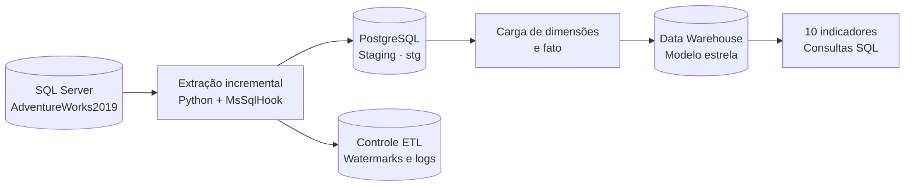

O **Apache Airflow** orquestra todo o fluxo com `LocalExecutor`. O PostgreSQL armazena tanto os metadados do Airflow quanto os dados do projeto: as tabelas de staging ficam no schema `stg`, os controles no schema `etl` e as tabelas dimensionais usam o prefixo `dw_` no schema padrão.

### Fluxo do DAG principal

O DAG **`etl_incremental_adventureworks`** possui 12 tarefas e agendamento diário (`@daily`), sem recuperação automática de períodos passados (`catchup=False`) e com uma execução ativa por vez.

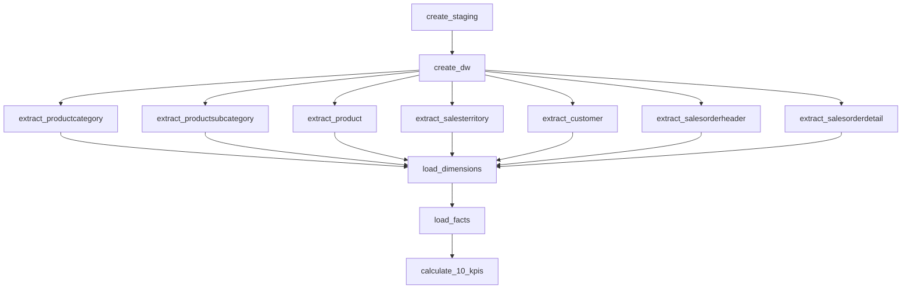

As sete extrações podem executar em paralelo, respeitando os limites configurados no Airflow. Cada tarefa tem uma tentativa adicional em caso de falha, com intervalo de um minuto.

### Estratégia incremental

1. Na primeira execução, são extraídos os registros com `ModifiedDate` até o horário consultado na origem.
2. Nas próximas execuções, a seleção começa **um dia antes do último watermark**, permitindo reler registros próximos ao limite da carga anterior.
3. Os dados são lidos em lotes de até **5.000 registros** e gravados na staging com `INSERT ... ON CONFLICT`.
4. Staging, watermark e log de extração são confirmados na mesma transação PostgreSQL, por tabela. Um lock transacional evita extrações simultâneas da mesma tabela por esse código.
5. As cargas do DW reavaliam a staging e atualizam apenas registros com conteúdo diferente. As dimensões seguem **SCD tipo 1**, substituindo os atributos anteriores.

> A estratégia depende da atualização de `ModifiedDate` na origem. Exclusões físicas e alterações retroativas fora da janela de sobreposição não são detectadas automaticamente. As cargas dimensionais e da fato consultam toda a staging; o filtro incremental é aplicado na extração do SQL Server.

## Modelo dimensional

O grão de **`dw_f_vendas`** é **um item de pedido**, identificado de forma única por `sales_order_detail_id`. A fato armazena quantidade, preço unitário, desconto, custo padrão e valor total, além das chaves para as quatro dimensões:

- **`dw_d_produto`** — produto, número, categoria e subcategoria.
- **`dw_d_cliente`** — identificação, nome e tipo de cliente: loja ou pessoa física.
- **`dw_d_territorio`** — território, país e região; inclui um membro para território não informado.
- **`dw_d_calendario`** — datas entre o menor e o maior pedido disponível na staging, com atributos de ano, mês, trimestre e dia.


O [arquivo editável do diagrama](data/diagrama/Modelo%20estrela%20de%20vendas.drawio) também está disponível no repositório.

Os campos monetários usam `NUMERIC(19,4)`, e os totais de linha usam `NUMERIC(38,6)`. O arquivo [`migrate_precision.sql`](dags/sql/migrate_precision.sql) ajusta essas precisões em estruturas existentes e cria índices nas chaves dimensionais da fato.

## Segurança e credenciais

O projeto é destinado à execução local para desenvolvimento e avaliação. As credenciais ficam no arquivo `.env` de cada instalação; esse arquivo é ignorado pelo Git e excluído do ZIP de entrega. O `.env.example` mantém os nomes das variáveis e as configurações públicas, com os valores secretos vazios.

O script [`configurar_ambiente.ps1`](scripts/configurar_ambiente.ps1) utiliza um gerador criptográfico para criar senhas independentes para PostgreSQL, SQL Server e o administrador do Airflow, além das chaves Fernet, API e JWT. Ele não exibe os valores e não sobrescreve um `.env` existente. Para consultar suas credenciais, abra o `.env` local em um editor; não compartilhe esse arquivo nem capturas do seu conteúdo.

O `docker-compose.yml` exige o preenchimento das credenciais obrigatórias e não fornece senhas padrão. Os serviços publicam suas portas em `127.0.0.1`, restringindo o acesso direto ao computador que executa os containers. As DAGs utilizam os identificadores `postgres_default` e `mssql_adventureworks`; as conexões são fornecidas por variáveis de ambiente.

### Alteração de credenciais em uma instalação existente

Com volumes já inicializados, editar o `.env` não altera automaticamente as senhas armazenadas nos bancos nem a senha do usuário do Airflow. A troca precisa atualizar os serviços e o arquivo local de forma coordenada. A substituição da chave Fernet exige a migração dos valores já criptografados. Preserve o `.env` e os volumes ao retomar uma instalação existente.

Senhas expostas devem ser substituídas nos respectivos serviços. Excluir um valor do arquivo atual não o remove do histórico Git nem de pacotes distribuídos anteriormente. Os scripts de configuração e entrega não reescrevem o histórico do repositório.

## Como executar

### Pré-requisitos

- Docker com suporte a containers Linux e Docker Compose v2.
- PowerShell 5.1 ou superior para os scripts de configuração e entrega.
- Git, caso obtenha o projeto por clonagem; não é necessário para usar o ZIP.
- Acesso à internet no primeiro início para baixar imagens, dependências Python e o backup do AdventureWorks.
- Memória disponível para os serviços: os limites configurados no Compose somam aproximadamente **7 GB**, além do consumo do Docker e do sistema operacional.
- Portas `8080`, `5433` e `1433` livres na configuração padrão.

Os exemplos abaixo usam **PowerShell**, a partir da raiz do projeto.

### 1. Obtenha o projeto

```powershell
git clone https://github.com/davs22/ApacheAirflow-e-ETL.git
cd ApacheAirflow-e-ETL
```

Se recebeu o ZIP da avaliação, extraia-o e abra o PowerShell dentro da pasta `ApacheAirflow-e-ETL`, onde estão `docker-compose.yml` e `readme.md`. Nesse caso, não execute `git clone`.

### 2. Configure o ambiente

Gere o arquivo local de configuração com senhas e chaves aleatórias exclusivas:

```powershell
powershell -ExecutionPolicy Bypass -File scripts/configurar_ambiente.ps1
```

O script cria o `.env` com as variáveis do `.env.example` e credenciais exclusivas. Se o arquivo já existir, ele será preservado. Para uma instalação nova, cada avaliador deve executar esse passo no próprio computador.

Antes de iniciar os serviços, valide a configuração sem imprimir seus valores:

```powershell
docker compose config --quiet
```

Se alguma variável obrigatória estiver vazia, o Compose interromperá a validação. Não use `docker compose config` sem `--quiet` ao preparar capturas ou arquivos para entrega, pois a saída pode incluir credenciais interpoladas.

### 3. Inicie os serviços

```powershell
docker compose up -d
docker compose ps --all
```

O Compose baixa o backup `AdventureWorks2019.bak`, restaura o banco caso ainda não exista, migra os metadados do Airflow e cria o usuário da interface. A primeira inicialização pode levar alguns minutos.

Aguarde a conclusão dos serviços `sqlserver-backup`, `sqlserver-init` e `airflow-init` com código de saída **0**, e verifique a saúde dos serviços que possuem healthcheck. Os componentes contínuos são PostgreSQL, SQL Server, API server, scheduler, DAG processor e triggerer.

### 4. Execute o pipeline

Abra **[localhost:8080](http://localhost:8080)**. Na configuração padrão, o usuário é `admin`; a senha gerada fica em `_AIRFLOW_WWW_USER_PASSWORD` no `.env` local. Se alterar o usuário antes da primeira inicialização, utilize o valor de `_AIRFLOW_WWW_USER_USERNAME`.

1. Localize `etl_incremental_adventureworks`.
2. Ative o DAG, criado inicialmente em pausa.
3. Dispare uma execução manual e acompanhe as tarefas e seus logs.
4. Após a carga, consulte as tabelas `dw_` no PostgreSQL e os resultados da tarefa `calculate_10_kpis`.

As conexões **`postgres_default`** e **`mssql_adventureworks`** já são configuradas pelo Compose. O DAG principal cria as próprias estruturas; os DAGs auxiliares são opcionais.

## Validar a carga

Uma execução completa deve terminar com as **12 tarefas em sucesso**, incluindo `calculate_10_kpis`. No PostgreSQL, execute as consultas abaixo pelo DBeaver ou outro cliente SQL conectado ao banco definido em `POSTGRES_DB`.

Confira a quantidade de registros em cada tabela do DW:

```sql
SELECT 'dw_d_produto' AS tabela, COUNT(*) AS registros FROM dw_d_produto
UNION ALL
SELECT 'dw_d_cliente', COUNT(*) FROM dw_d_cliente
UNION ALL
SELECT 'dw_d_territorio', COUNT(*) FROM dw_d_territorio
UNION ALL
SELECT 'dw_d_calendario', COUNT(*) FROM dw_d_calendario
UNION ALL
SELECT 'dw_f_vendas', COUNT(*) FROM dw_f_vendas;
```

Verifique os watermarks e o histórico recente de extração:

```sql
SELECT tabela, watermark
FROM etl.watermark
ORDER BY tabela;

SELECT run_id, tabela, limite_inferior, limite_superior, lidos, alterados
FROM etl.extraction_log
ORDER BY id DESC
LIMIT 21;
```

Após a primeira carga completa, devem existir **sete watermarks**, um por tabela de origem. Em uma nova execução sem alterações na origem, `lidos` pode continuar maior que zero por causa da sobreposição de um dia, enquanto `alterados` deve ser zero. A quantidade de itens na fato deve permanecer estável.

## Indicadores de negócio

O arquivo [`kpis_adventureworks.sql`](dags/sql/kpis_adventureworks.sql) contém dez consultas executadas ao final do pipeline:

1. **Faturamento líquido** — soma dos valores totais dos itens.
2. **Custo total estimado** — quantidade multiplicada pelo custo padrão do produto.
3. **Lucro bruto estimado** — faturamento menos custo estimado.
4. **Margem bruta estimada (%)** — lucro estimado em relação ao faturamento.
5. **Total de pedidos** — contagem distinta dos pedidos de venda.
6. **Ticket médio por pedido** — faturamento dividido pela quantidade de pedidos.
7. **Unidades vendidas** — soma das quantidades dos itens.
8. **Faturamento por categoria** — receita agrupada pela categoria do produto.
9. **Faturamento por região e território** — distribuição geográfica da receita.
10. **Top 10 produtos por lucro bruto estimado** — produtos com maior contribuição estimada.

> A receita considera o total dos itens após descontos, sem frete e impostos. O custo usa o `StandardCost` atual do produto, portanto lucro e margem são estimativas, sem reconstrução do custo histórico contábil. Os resultados são impressos nos logs da tarefa; as consultas não criam tabelas de indicadores.

Com `AIRFLOW_LOGGING_LEVEL=INFO`, os logs de `calculate_10_kpis` mostram as colunas, a quantidade de linhas e os resultados de cada consulta, incluindo os agrupamentos e o top 10. Também é possível executar o arquivo SQL diretamente no PostgreSQL.

## Operação e acompanhamento

Para verificar erros de importação e acompanhar os serviços:

```powershell
docker compose exec -T airflow-scheduler airflow dags list-import-errors
docker compose logs -f airflow-scheduler
```

Para executar o DAG completo pelo comando de teste do Airflow:

```powershell
docker compose exec -T airflow-scheduler airflow dags test etl_incremental_adventureworks
```

Esse comando **executa as tarefas e grava nos bancos configurados**. Utilize-o com os serviços prontos e sem uma execução concorrente do pipeline.

### DAGs auxiliares

Os três DAGs abaixo possuem execução manual, sem agendamento:

- **`etl_build_schema_stg_adventureworks`** — cria as estruturas de staging e controle ETL.
- **`etl_build_schema_dw_adventureworks`** — cria as dimensões e a fato do modelo estrela, mesmo antes de existir a staging. O calendário é preenchido por `load_dimensions` no DAG principal, após a extração dos pedidos.
- **`etl_extract_mssql_adventureworks`** — prepara a staging e executa as sete extrações.

Evite executá-los em paralelo com o DAG principal durante manutenções.

Para a carga completa e a execução diária, ative `etl_incremental_adventureworks`. Os DAGs auxiliares só executam suas respectivas etapas quando acionados manualmente.

### Conexão pelo DBeaver ou outro cliente SQL

- **PostgreSQL:** host `localhost`, porta `5433` e banco, usuário e senha definidos no `.env`. A porta pode ser alterada por `POSTGRES_HOST_PORT`.
- **SQL Server:** host `localhost`, porta `1433`, banco `AdventureWorks2019`, usuário `sa` e senha definida em `MSSQL_SA_PASSWORD` no `.env`. A porta pode ser alterada por `MSSQL_HOST_PORT`.
- **Airflow:** interface na porta `8080`, configurável por `AIRFLOW_PORT`.

Entre containers, o PostgreSQL é acessado por `postgres:5432` e o SQL Server por `sqlserver:1433`.

### Persistência e diagnóstico

Os bancos e o backup utilizam volumes Docker. Para parar o ambiente preservando os dados:

```powershell
docker compose down
```

O parâmetro `-v` remove os volumes e seus dados. As pastas `dags`, `logs`, `plugins`, `config` e `data` são montadas em `/opt/airflow`.

Se houver falha na inicialização, consulte os logs dos serviços de preparação:

```powershell
docker compose logs sqlserver-backup sqlserver-init airflow-init
```

### Problemas frequentes

- **DAG ausente ou erro de importação:** execute `airflow dags list-import-errors` pelo comando acima e confira `_PIP_ADDITIONAL_REQUIREMENTS`. A extração exige `apache-airflow-providers-microsoft-mssql`; o módulo compartilhado também utiliza `sqlparse`, disponível na imagem do Airflow.
- **SQL Server indisponível:** confira os logs de `sqlserver` e `sqlserver-init`, a senha `MSSQL_SA_PASSWORD` e a conclusão da restauração do backup.
- **Calendário vazio após criar o schema:** execute o DAG principal. O preenchimento depende dos pedidos na staging e acontece em `load_dimensions`.
- **Indicadores ausentes nos logs:** defina `AIRFLOW_LOGGING_LEVEL=INFO`, aplique com `docker compose up -d` e dispare uma nova execução. Mensagens omitidas em execuções anteriores com nível `WARNING` não são recuperadas.
- **Variável obrigatória ausente:** em uma instalação nova, execute `scripts/configurar_ambiente.ps1`. Se já houver `.env`, confira as variáveis exigidas no `.env.example` sem substituir credenciais de uma instalação existente de forma isolada.
- **Falha de autenticação após editar o `.env`:** as senhas dos serviços podem continuar com os valores anteriores. Confira o procedimento de alteração de credenciais e preserve os volumes.
- **Pressão de memória:** reduza `AIRFLOW_PARALLELISM` e `AIRFLOW_MAX_ACTIVE_TASKS_PER_DAG` e aplique a configuração com `docker compose up -d`.

## Estrutura do projeto

```text
ApacheAirflow-e-ETL/
├── dags/
│   ├── aw_pipeline.py
│   ├── etl_incremental_vendas.py
│   ├── etl_extract_mssql_to_stg.py
│   ├── etl_build_schema_stg.py
│   ├── etl_build_schema_dw.py
│   └── sql/
│       ├── stg_adventureworks.sql
│       ├── dw_d_*.sql
│       ├── dw_f_vendas.sql
│       ├── migrate_precision.sql
│       ├── load_dimensions.sql
│       ├── load_facts.sql
│       └── kpis_adventureworks.sql
├── data/
│   ├── diagrama/
│   └── img/
├── scripts/
│   ├── configurar_ambiente.ps1
│   └── gerar_entrega.ps1
├── .env.example
├── .gitignore
├── docker-compose.yml
└── readme.md
```

[`aw_pipeline.py`](dags/aw_pipeline.py) concentra a extração incremental, a execução dos SQLs e a inicialização do DW. [`etl_incremental_vendas.py`](dags/etl_incremental_vendas.py) define as tarefas e dependências do fluxo principal. O ambiente usa o arquivo [`docker-compose.yml`](docker-compose.yml). Os scripts em `scripts/` cuidam da configuração local e da montagem do pacote de entrega. O `.env` é criado localmente; `output/entrega/` é gerado pelo empacotamento. Ambos ficam fora do versionamento.

## Entrega do projeto

### Gerar o ZIP

Execute na raiz do projeto:

```powershell
powershell -ExecutionPolicy Bypass -File scripts/gerar_entrega.ps1
```

O pacote será criado em **`output/entrega/ApacheAirflow-e-ETL.zip`**. Ele contém as DAGs Python, os scripts SQL, as imagens, o diagrama editável, a documentação, o Compose, o `.env.example` e os dois scripts PowerShell. Também inclui as pastas vazias `config`, `plugins` e `logs` utilizadas pelos volumes locais.

O empacotamento usa uma lista explícita de arquivos e exclui `.env`, histórico Git, logs de execução, caches, backups e outros arquivos de saída. Quando há um `.env` local, também verifica se os arquivos selecionados contêm seus valores secretos e interrompe a geração se encontrar uma correspondência. Gere novamente o ZIP após alterar o código ou a documentação; o script atualiza somente o pacote em `output/entrega/`.

### Executar como avaliador

Após extrair o ZIP, abra o PowerShell na pasta do projeto e execute:

```powershell
powershell -ExecutionPolicy Bypass -File scripts/configurar_ambiente.ps1
docker compose config --quiet
docker compose up -d
docker compose ps --all
```

Aguarde os serviços de preparação concluírem com código `0`, abra a interface do Airflow e execute `etl_incremental_adventureworks`, conforme o roteiro em **Como executar**. Cada avaliador utiliza credenciais próprias; o pacote não depende das senhas do autor.

### Repositório e pacote de entrega

O código-fonte está em **[davs22/ApacheAirflow-e-ETL](https://github.com/davs22/ApacheAirflow-e-ETL)**. Entregue esse endereço junto ao ZIP atualizado. O histórico Git não acompanha o pacote; o `.env` permanece somente na instalação local.

## Galeria

Registros visuais disponíveis no repositório.

### DAGs no Airflow

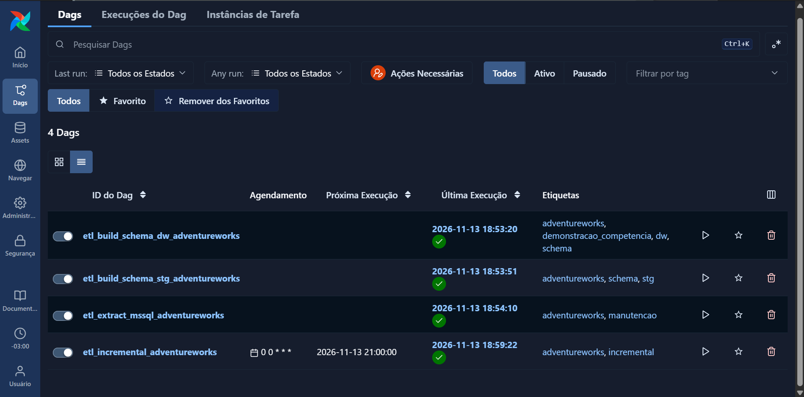

<details>
<summary><strong>Pipeline incremental e logs</strong></summary>

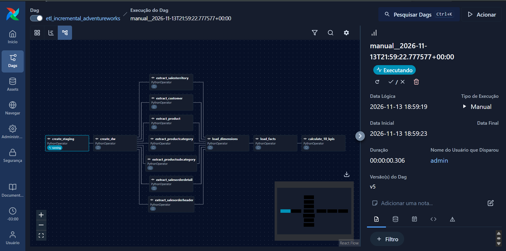

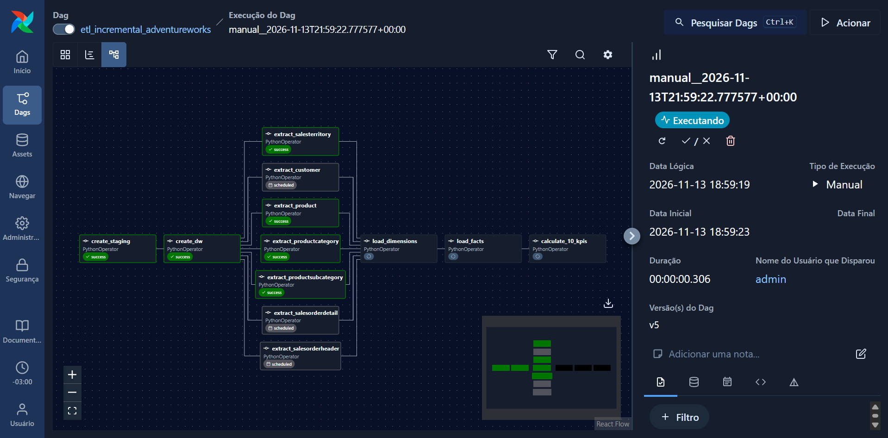

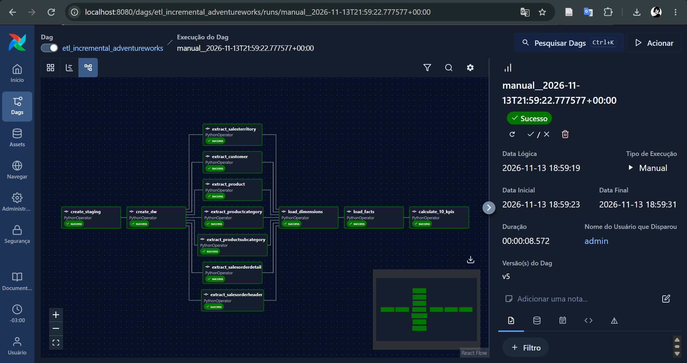

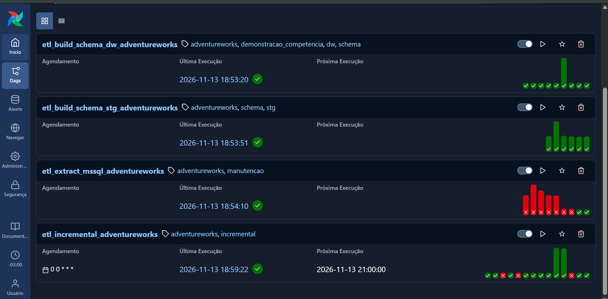

</details>

<details>
<summary><strong>Criação das estruturas e extração</strong></summary>

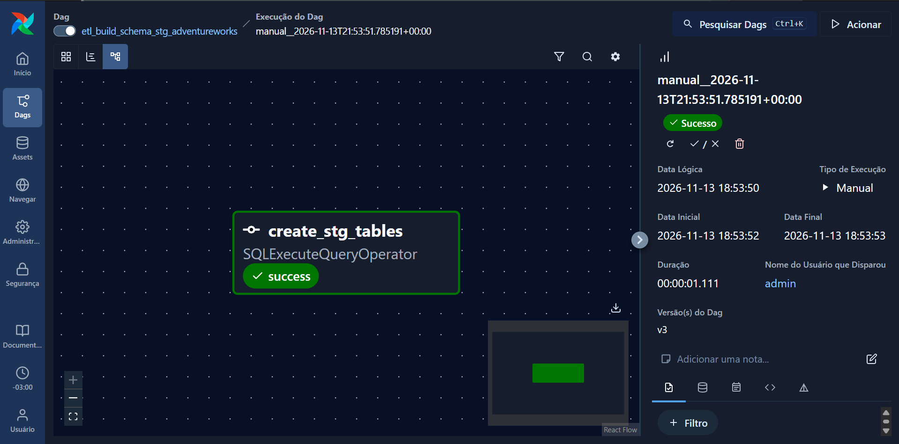

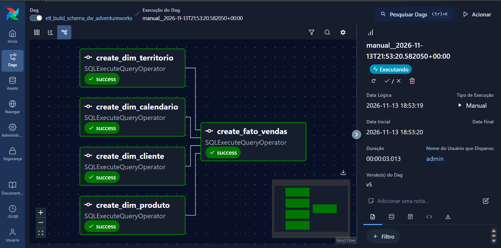

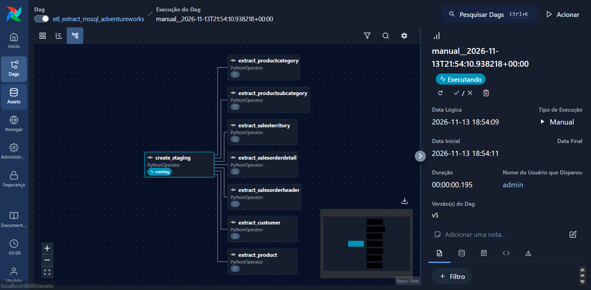

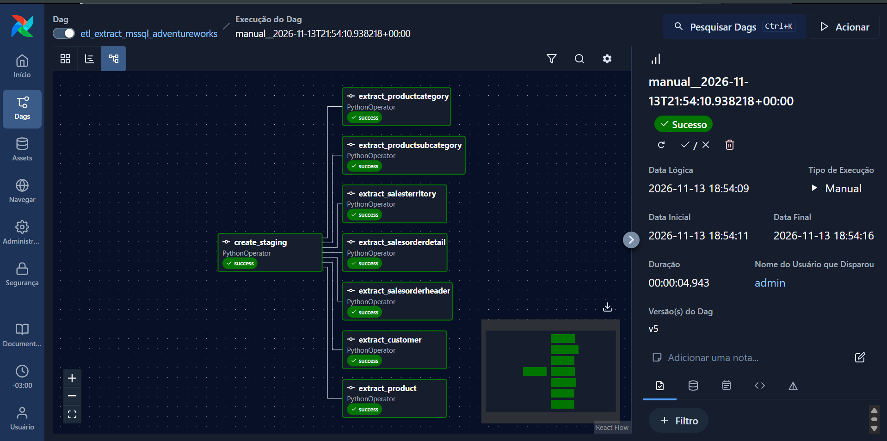

</details>

---

<div align="center">

**AdventureWorks · Apache Airflow · PostgreSQL · Docker**

[Acessar o repositório](https://github.com/davs22/ApacheAirflow-e-ETL)

</div>
